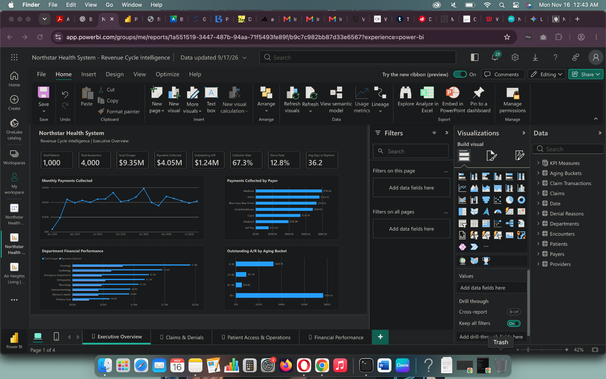
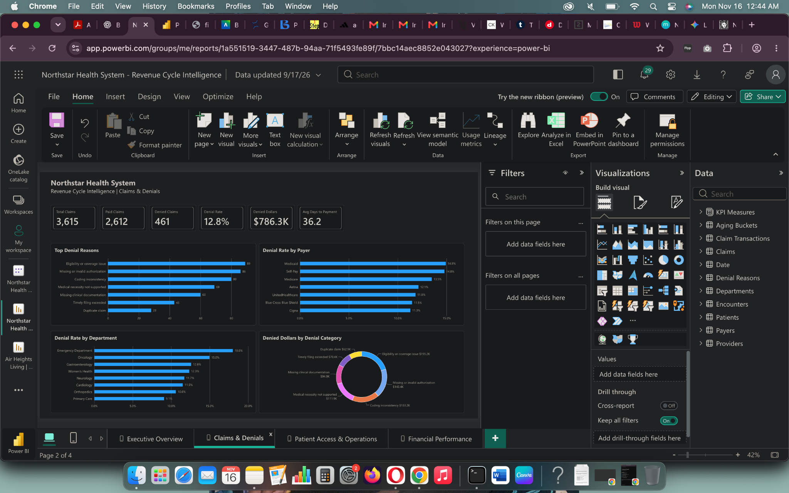
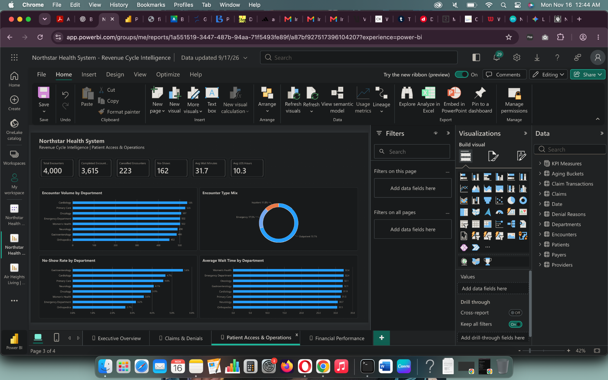
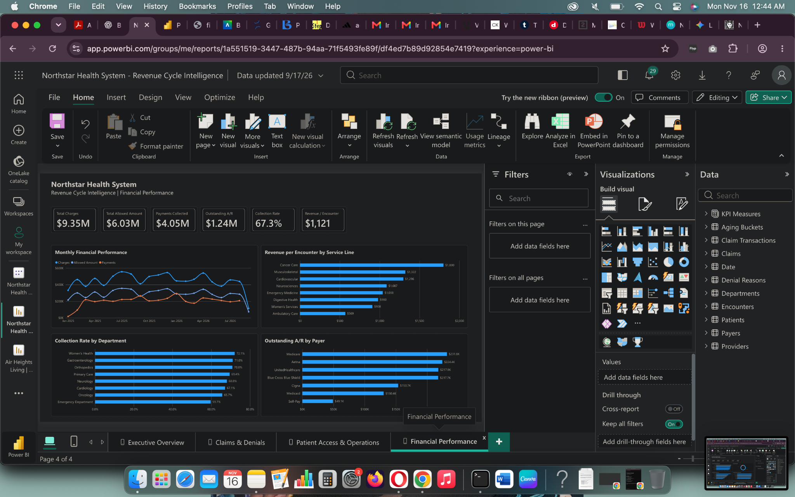
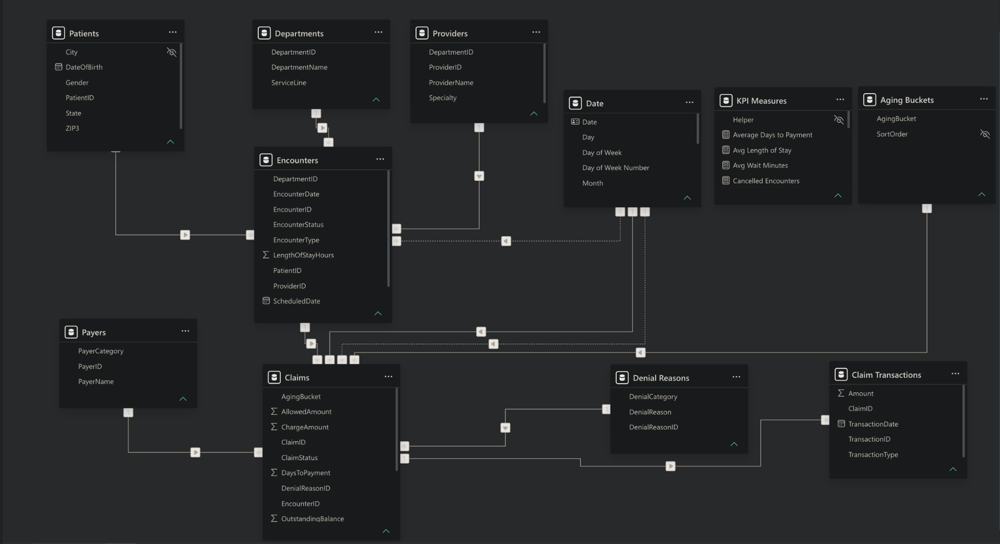
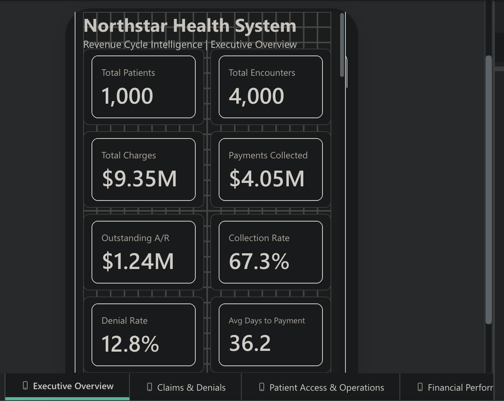
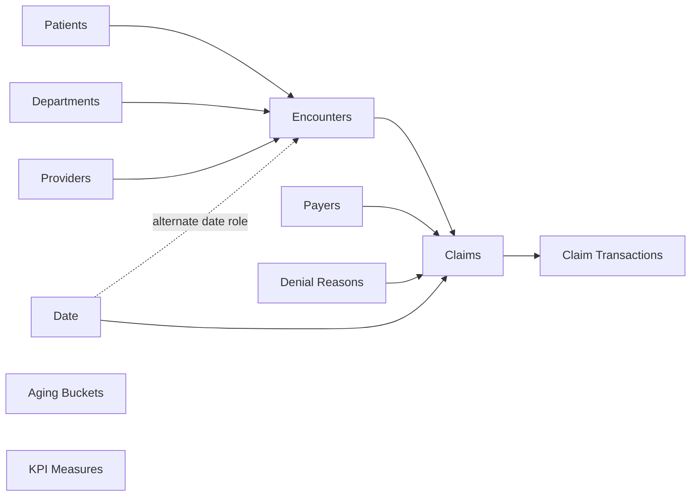

# Northstar Health System | Revenue Cycle Intelligence

Power BI healthcare business intelligence project focused on revenue-cycle performance, reimbursement risk, patient access, financial performance, data governance, and mobile reporting.

> Portfolio project using synthetic healthcare data. No real patient or protected health information is included.

## Project Overview

Northstar Health System is a four-page Power BI solution designed to help healthcare leaders move from high-level financial monitoring into the payer, department, denial, service-line, and operational factors driving performance.

The project covers the full BI workflow: source design, data modeling, relationship management, DAX measures, KPI validation, desktop reporting, mobile optimization, and governance considerations.

## Dashboard Preview

### Executive Overview


### Claims & Denials


### Patient Access & Operations


### Financial Performance


### Semantic Model


### Mobile Executive Overview


## Business Questions

- Where is revenue being lost or delayed?
- Which payers and departments generate the greatest denial exposure?
- What is driving outstanding accounts receivable?
- How do charges, allowed amounts, and payments compare over time?
- Which service lines produce the strongest revenue per encounter?
- Are no-shows, wait times, or other operational issues concentrated in specific departments?

## Report Pages

1. Executive Overview
2. Claims & Denials
3. Patient Access & Operations
4. Financial Performance

## Key Findings

| Metric / Finding | Result |
|---|---:|
| Total Charges | $9.35M |
| Total Allowed Amount | $6.03M |
| Payments Collected | $4.05M |
| Outstanding A/R | $1.24M |
| Collection Rate | 67.3% |
| Denial Rate | 12.8% |
| Denied Dollars | $786.3K |
| Avg Days to Payment | 36.2 |
| Revenue per Encounter | $1,121 |
| Highest Department Denial Rate | Emergency Department, 18.0% |
| Highest Payer Denial Rate | Medicaid, 14.9% |
| Highest Department Collection Rate | Women’s Health, 72.1% |
| Highest Revenue per Encounter | Cancer Care, approx. $1,800 |

The 90+ day aging bucket represented the largest concentration of unpaid balances. Eligibility or coverage issues were the most frequent denial reason, pointing to front-end verification as a potential improvement opportunity.

## Semantic Model

The model separates dimensions from transactional activity rather than relying on one flattened table.



Core design choices:
- one-to-many relationships for primary analytical paths
- single-direction filtering to reduce ambiguity
- dedicated Date dimension
- inactive relationships for alternate date roles
- dedicated KPI Measures table
- separate aging-bucket structure for A/R analysis

See [Data Model & Architecture](docs/data-model.md).

## DAX & Analytical Logic

Representative measures include Total Charges, Total Allowed Amount, Payments Collected, Outstanding A/R, Collection Rate, Denial Rate, Denied Dollars, Average Days to Payment, Revenue per Encounter, No-Show Rate, Average Wait Minutes, and Average Length of Stay.

See [KPI Reference](docs/kpi-reference.md).

## Data Governance & Quality

The source design includes a data dictionary and governance rules covering identifier completeness, referential integrity, payer validation, denial-reason completeness, payment-date requirements, outstanding-balance controls, transaction validation, and refresh expectations.

Controlled missing values and data-quality exceptions were intentionally preserved for validation rather than automatically removed.

See [Governance & Data Quality](docs/governance.md).

## Mobile Optimization

All four report pages were redesigned specifically for mobile consumption. Adjustments included two-column KPI layouts, simplified labels, resized visuals, continuous time axes, reduced label density, and removal of unnecessary legends and scrollbars.

## Tools & Skills

Power BI • Power Query • DAX • Semantic Modeling • Relationship Design • KPI Development • Healthcare Revenue Cycle Analytics • Financial Analysis • Data Validation • Data Governance • Data Quality • Mobile Report Optimization

## Repository Structure

```text
northstar-health-revenue-cycle-bi/
├── README.md
├── data/
│   └── Northstar_Health_Revenue_Cycle_Source.xlsx
├── docs/
│   ├── data-model.md
│   ├── governance.md
│   └── kpi-reference.md
└── screenshots/
    ├── executive-overview.png
    ├── claims-denials.png
    ├── patient-access-operations.png
    ├── financial-performance.png
    ├── semantic-model.png
    └── mobile-executive-overview.png
```

## Data Disclaimer

This project was created for portfolio demonstration using synthetic data. It does not contain real patient records, PHI, or confidential organizational data.
